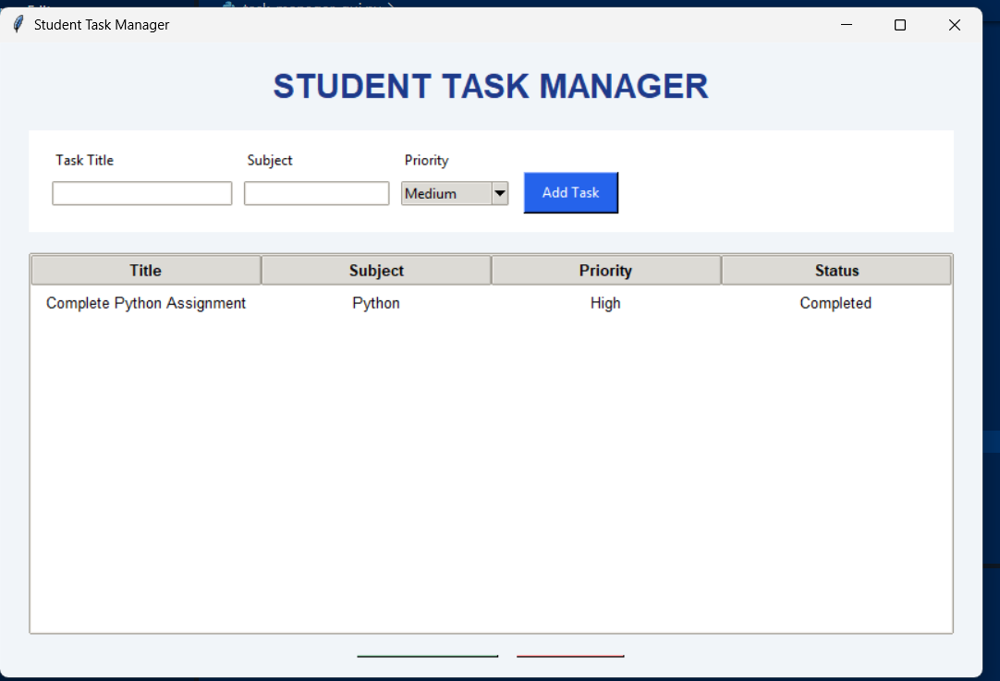

# Student Task Manager

A Python-based task management application designed to help students organize, track, and manage their academic tasks efficiently.

## Application Screenshot



## Features

- **Add Tasks:** Create tasks with a title, subject, and priority.
- **View Tasks:** Display all tasks in a table.
- **Search Tasks:** Search for tasks by title or subject.
- **Clear Search:** Return to the full task list with one click.
- **Mark Completed:** Update tasks when they are finished.
- **Delete Tasks:** Remove tasks with a confirmation prompt.
- **Priority Selection:** Assign High, Medium, or Low priority.
- **Data Persistence:** Save tasks locally using JSON so they remain available when the application is reopened.
- **Input Validation:** Display warnings when required information is missing.

## Technologies Used

- **Python** — application logic
- **Tkinter** — graphical user interface
- **JSON** — local task storage
- **Git and GitHub** — version control and project hosting

## Project Structure

```text
Student-Task-Manager/
├── task_manager.py
├── task_manager_gui.py
├── README.md
├── .gitignore
└── student-task-manager.png
```

## Requirements

- Python 3
- Tkinter (included with most standard Python installations)

## How to Run

1. Clone or download this repository.
2. Open the project folder in VS Code or a terminal.
3. Run the graphical application:

   ```bash
   python task_manager_gui.py
   ```

To run the console version instead:

```bash
python task_manager.py
```

## Data Storage

Tasks are stored locally in `tasks.json`. The file is created when tasks are saved. It is excluded from Git using `.gitignore` so personal task data is not uploaded accidentally.

## Learning Outcomes

This project demonstrates:

- Python functions and data structures
- GUI development using Tkinter
- File handling and JSON serialization
- Input validation and event handling
- Basic search and filtering
- Git version control and GitHub collaboration

## Future Enhancements

- Filter tasks by priority and completion status
- Add due dates and reminders
- Edit existing tasks
- Add task statistics and a dashboard

## Author

**Manya Acharya**

